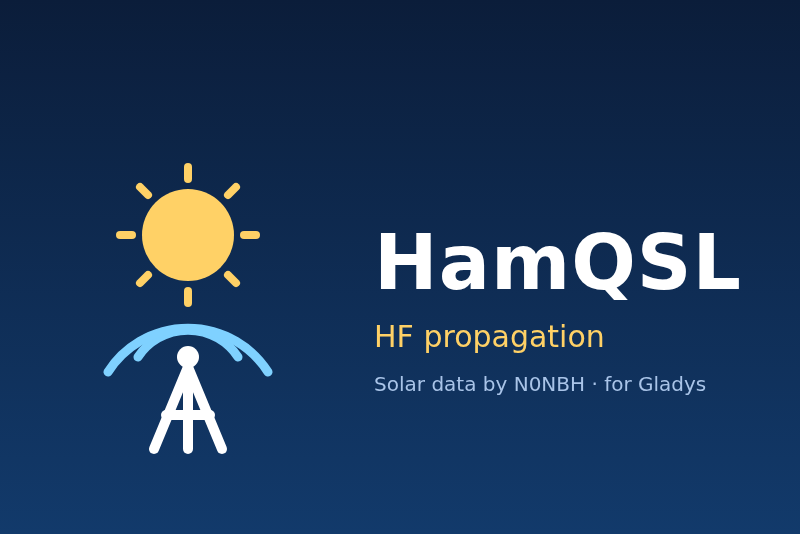

# Gladys HamQSL

HF and VHF radio propagation in [Gladys Assistant](https://gladysassistant.com), for radio
amateurs, from the public solar data feed of Paul Herrman, N0NBH
([hamqsl.com](https://www.hamqsl.com/solar.html)).



## What it does

- **One device**, "HF propagation (HamQSL)": solar flux (SFI), sunspot number, K and A indices,
  X-ray class, solar wind, Bz, signal noise, geomagnetic field, the condition of each HF band group
  by day and by night (80-40 m, 30-20 m, 17-15 m, 12-10 m: 0 Poor, 1 Fair, 2 Good, drawn as antenna
  bars), VHF aurora and sporadic E openings, and the time of the N0NBH update.
- **A dashboard widget**: the band table, with the main indices as tiles.
- **Scene triggers**: a band becomes Good (band, day or night), a geomagnetic storm (K index, NOAA
  G scale), an M or X class solar flare.
- **A scene action**: the propagation bulletin as one text, plus the main values.
- Texts in English, French, German and Spanish.

The feed is read every hour by default (30 minutes at most, as N0NBH asks), with a User-Agent that
names the integration. No account, no key: the integration only reads a public feed.

For aurora watching (NOAA Kp forecast and alerts), see
[gladys-astronomy](https://github.com/guim31/gladys-astronomy): this integration does not duplicate
it.

## Requirements

- Gladys Assistant 5.1.0 or later.
- Internet access from Gladys to `www.hamqsl.com`.

## Installation

In Gladys: **Integrations → Install from GitHub**, address
`https://github.com/guim31/gladys-hamqsl`. Choose the language and the refresh interval, save,
then create the device in the **Discover** tab.

User documentation: [English](docs/en.md), [français](docs/fr.md), [Deutsch](docs/de.md),
[español](docs/es.md).

## Limits

- The band conditions are N0NBH's global model, computed from the indices hourly: not a
  measurement at your location, nor for a given path.
- The X-ray class is read at each refresh: a short flare between two readings can be missed.
- No MUF or foF2 (the feed publishes none).

## Development

```bash
npm ci
npm run format:check && npm run lint && npm test
npx -y github:GladysAssistant/integration-store --skip-image-check .
```

The tests run against the SDK's fake Gladys and the recorded feed of `test/fixtures/`: they never
touch the network. See `CLAUDE.md` for the architecture and the rules of the repository.

## Credits

- Solar-terrestrial data courtesy of Paul Herrman, N0NBH:
  [hamqsl.com/solar.html](https://www.hamqsl.com/solar.html). Please respect his request to read
  the feed no more often than every 30 to 60 minutes.
- Built on the official
  [integration template](https://github.com/GladysAssistant/integration-template-js) and
  [SDK](https://github.com/GladysAssistant/integration-sdk-js) of Gladys Assistant.

Not affiliated with HamQSL or N0NBH.

## License

[Apache-2.0](LICENSE)
